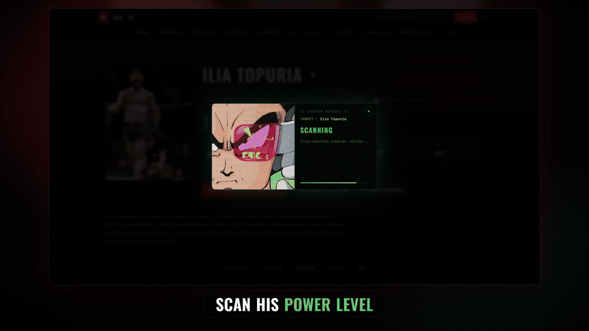
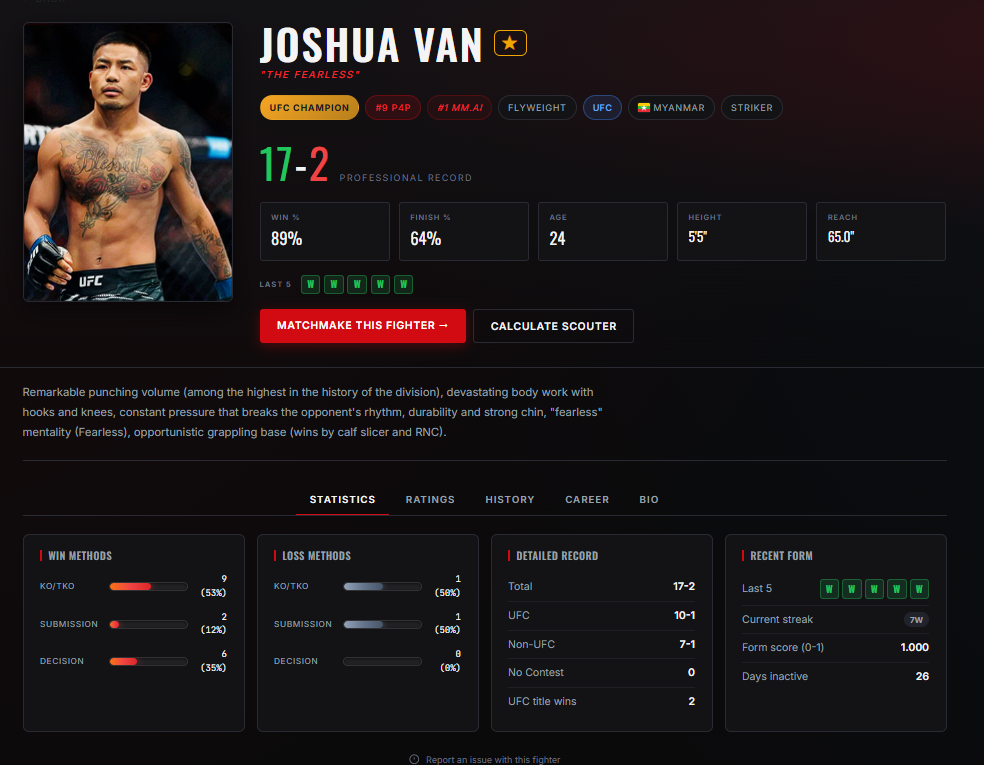

# MM.AI v0.3 — MMA analytics & fight prediction

**Who wins tonight?** MM.AI rates every MMA fighter and predicts fights from their full career —
UFC, PFL, Bellator, ONE and regional circuits — with an Elo engine, a 0–100 *Scouter* rating
and a *Dragon Ball Z* power-level reveal. 🟣

> [!NOTE]
> This is **v0.3, the first version** of the project, kept public as a showcase.
> The ratings and predictions in this repo are **early, simplified algorithms — not the real ones.**
> The project grew into **RoundZero** (website + app), which runs a completely new engine (not open source).
> 👉 [See RoundZero below](#-what-it-became-roundzero)

<p align="center">
  <a href="docs/media/mmai-v03-promo.mp4">
    
  </a>
  <br><sub>▶ Click for the full video with sound (34 s): Topuria's fighter page → "Calculate Scouter" → Topuria vs Ferguson, Legendary vs Frieza level → the prediction and its data. Recorded on the real site.</sub>
</p>

## Highlights

- **~11,300 fighters / ~151,000 fights** when MM.AI was built — the same database now holds **50,000+ fighters**, which is what the video runs on (data not included, see below)
- **Elo engine** replaying each fighter's whole fight history, weighting opponents by the level of the promotion
- **Scouter rating (0–100)**: a single score for a fighter's current level, with DBZ tiers from *Earthling* to *Legendary*
- **Matchmaking**: win probability, likely method & round, tale of the tape, factor breakdown, style matchup
- **AI-written fight analysis** with a reliability gauge (Gemini / OpenRouter / Groq, with a no-AI fallback)
- Rankings, divisions, P4P, events, analytics, fighter comparison
- Accounts (JWT, email verification, favorites), **admin panel with 2FA**, **8 languages**, dark/light theme

<p align="center">
  
  
</p>

## Stack

| Layer    | Tech |
|----------|------|
| Database | PostgreSQL (Supabase in production) |
| Backend  | Python · Flask (public API + static server) · FastAPI sandbox (Swagger) · psycopg2 |
| ML       | Elo engine, Scouter rating, skills & matchup predictor, backtesting — plain Python / NumPy |
| Frontend | Vanilla HTML / CSS / JS, no framework, i18n in 8 languages |
| AI layer | LLM API (Gemini by default) — writes the explanation, never makes the prediction |

```
api/        Flask API + static file server (entry point: api/app.py)
backend/    FastAPI sandbox + ML code (backend/src/ml: elo, scouter, skills, matchup predictor)
database/   PostgreSQL schema, migrations, batch rating scripts
frontend/   HTML / CSS / JS pages
docs/       screenshots and demo media
```

The data collection side lives in its own repo: [mma-scraper](https://github.com/kalmossa/mma-scraper).

## 🚀 What it became: RoundZero

MM.AI was my final-year project. I kept building it, and it became **RoundZero**: new prediction
engine, new design, community games (daily mystery fighter, overrated/underrated…) and a mobile app.
RoundZero is not open source — this repo is where it all started.

<p align="center">
  <a href="docs/media/roundzero-teaser.mp4">
    
  </a>
  <br><sub>RoundZero teaser (work in progress). Click for the full video with sound.</sub>
</p>

## About the data

**This repository contains no fighter data.** The original database was built by scraping public
sources and lived on Supabase; that data is not mine to redistribute. If you run the site as is,
it will be **empty** — you would need your own PostgreSQL database and data.
The video above was recorded with this exact code running on the original database (read-only).

What runs without any data is the FastAPI sandbox, which falls back to 3 built-in sample fighters.

## Running it

**FastAPI sandbox (no database needed, sample data):**

```bash
cd backend
pip install fastapi uvicorn numpy psycopg2-binary python-dotenv
PYTHONPATH=src uvicorn api.app:app --reload     # Windows PowerShell: $env:PYTHONPATH="src"
# → http://localhost:8000/docs
```

**Full site (needs your own PostgreSQL + data):**

```bash
pip install -r api/requirements.txt
cp .env.example .env                             # fill in your database settings
# create the tables: run database/schema_mmai.sql, then database/migrations/*.sql in order
python api/app.py                                # → http://localhost:5000
```

**Tests:**

```bash
pip install pytest numpy
pytest backend/tests -rs
```

> `test_elo_dynamic.py` is **skipped on purpose**: it was written for the very first Elo calculator,
> which was rewritten afterwards. It is kept as a trace of the project's history, so seeing it as
> *skipped* is expected, not a bug.

Every page of the site shows a banner reminding visitors that this is the v0.3 showcase, and the
prediction endpoints return a `demo_notice` field saying the same.

## Credits & disclaimers

- Not affiliated with the UFC or any promotion. Fighter names and photos belong to their owners.
- The *Dragon Ball Z* GIFs, images and the scouter sound used by the site are fan references; they belong to their respective rights holders.
- RoundZero teaser photos: credits are shown at the end of the video.
- Author: [Elias Lallouet](https://github.com/kalmossa)
